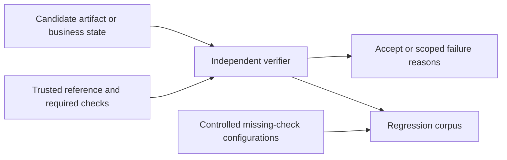

# Quality Gate architecture

Programmatic acceptance uses an independent reference, not a candidate's own
success text. The binary artifact adapter recomputes scores by separate arithmetic
against sklearn-generated reference artifacts. The business adapter compares
actual version, authorization, receipt and index-state fields. The experimental
adapter also performs real clean execution/fit diagnostics. The release test
executes predeclared missing-check configurations against a labeled regression
corpus; these are controlled configuration regressions, not discovered production
incidents. Static fixture timing is not full experiment verification latency.

The retained KB project's exact paired statistics are loaded through a small
adapter. Its original evaluator is not represented as the author of new task
labels or new result-verifier logic. An additional real-Agent no-feedback control
compares the verifier-feedback package on a predeclared12-task subset.

## Standalone packaging

The package namespace and project CLI are new. Domain execution/verification logic is retained from the measured source commit. Dependencies and assets are self-contained; no sibling checkout or original workstation path is required. See PROVENANCE.json for per-file identity.
